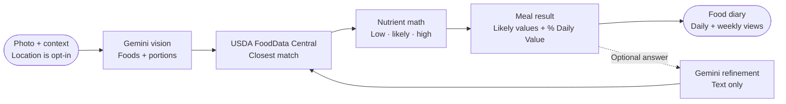

<div align="center">

<a href="https://app.mealscholar.health">
  
</a>

# MealScholar

**Study your plate. Be a MealScholar.**

A HackUMass XIV project.

<p>
  
  
  
  
  
  
  
</p>

[Open the app](https://app.mealscholar.health) · [Visit the website](https://mealscholar.health)

[Features](#at-a-glance) · [Quick start](#quick-start) · [Workflow](#workflow) · [Development](#development) · [Team](#team)

</div>

---

MealScholar is a photo-based food diary built for students.
Gemini identifies foods and estimates their portions; USDA FoodData Central supplies the nutrition
facts. Review the matches, correct one and log your meal.

> [!IMPORTANT]
> **The AI never invents nutrient numbers.** Nutrients come from USDA FoodData Central and
> arithmetic, not from the model.

<p align="center">
  <a href="https://app.mealscholar.health">
    
  </a>
  <br>
  <sub>Photo upload, captured from an earlier local app build.</sub>
</p>

## At a glance

| Feature | What you get |
|---|---|
| **Photo analysis** | JPEG, PNG and HEIC uploads up to 25 MB and 50 megapixels; foods and portion estimates with boxes on the photo. |
| **Estimates, ranges on request** | One likely number per amount by default. Turn on Show ranges (asked once in onboarding, a switch in Settings) to see low, likely and high for portions and nutrients. At most one clarifying question. |
| **Check the match** | See which USDA food each item matched, pick another one, or type the exact grams. |
| **Your food diary** | Meals with retained, metadata-stripped photos; daily calorie/nutrient totals, % Daily Value and weekly views. |
| **Phone-first app** | Today and Week views, camera entry points and Add to Home Screen. |
| **No sign-in** | One diary per server, stored locally in SQLite. Goals and display settings live beside it. |

### Current limitations

- **One diary per server.** There are no accounts: everyone who can reach the server shares one
  diary and one set of preferences. Run it for yourself, or keep it on a trusted network.

See [TODO.md](TODO.md) for remaining work.

## Quick start

You'll need [Git](https://git-scm.com/) and [uv](https://docs.astral.sh/uv/).
uv installs Python 3.12 if needed. No frontend build step is required.

**1. Clone and install**

```sh
git clone https://github.com/hershey-harsh/HackUmass-26-MealScholar.git
cd HackUmass-26-MealScholar
uv sync
```

**2. Create `.env` in the project root**

Get a Gemini API key from [Google AI Studio](https://aistudio.google.com/apikey), then add:

```dotenv
GEMINI_API_KEY=your-key-here
```

Shell variables override `.env`, and `.env` is gitignored.

**3. Import USDA data and start the app**

```sh
uv run mealscholar fdc-import
uv run mealscholar serve
```

Open **[localhost:8000](http://127.0.0.1:8000)**, choose a photo and review the detected foods.
The one-time import downloads roughly 17 MB and creates `~/.mealscholar/fdc.sqlite`.
The local interactive API documentation is at **[/api/docs](http://127.0.0.1:8000/api/docs)**;
the public deployment may restrict developer-documentation routes.

<details>
<summary><strong>Testing from your phone</strong></summary>

```sh
uv run mealscholar serve --host 0.0.0.0
```

Open your computer's LAN address on the same Wi-Fi. Browser geolocation needs HTTPS or
`localhost`, so the location switch will not work over an ordinary LAN HTTP address.
Keep this server on a trusted network: anyone who can reach it uses the same diary.

</details>

## Workflow



Foods without a close USDA match are suggestions, not counted foods, until a match is selected.
Choosing another USDA food recomputes the result without another photo analysis.


## Command line

```sh
# Analyze a photo and print the full result.
uv run mealscholar analyze lunch.jpg --json

# Review today's meals and the weekly summary.
uv run mealscholar day
uv run mealscholar week
```

<details>
<summary><strong>Analysis options, corrections and saved meals</strong></summary>

```sh
# Opt in to the photo's GPS, or supply device context.
uv run mealscholar analyze lunch.jpg --use-photo-location
uv run mealscholar analyze lunch.jpg --lat 42.39 --lon -72.53 --taken-at 2026-11-14T12:30-05:00

# Supply the clarifying answer without an interactive prompt.
uv run mealscholar analyze lunch.jpg --answer "fried in oil" --json

# Inspect meal 3 and find a different USDA match.
uv run mealscholar show 3
uv run mealscholar search "rice, white, cooked"
uv run mealscholar fix 3 1 --food 2708404

# Optional exact-weight correction for item 1 in meal 3.
uv run mealscholar fix 3 1 --grams 300

# Remove meal 3 from the diary, e.g. one logged from the wrong photo.
uv run mealscholar delete 3
```

`--json` prints the full `MealResult`. The CLI and the web app share the same local diary.

</details>

## Configuration

Set these in `.env` or your shell.

| Variable | Default | Purpose |
|---|---|---|
| `GEMINI_API_KEY` | Not set | Required for photo analysis. |
| `MEALSCHOLAR_MODEL` | `gemini-4-hydrogen` | Vision model; see [model benchmarks](BENCHMARK.md). |
| `MEALSCHOLAR_THINKING` | `low` | Thinking level. Gemini 4 supports `low`, `medium`, `high`, `xhigh`; `minimal` is for 3.x Flash/Flash-Lite only. |
| `MEALSCHOLAR_HOME` | `~/.mealscholar` | USDA database, downloads, SQLite diary and preferences, and logged meals' photos. |
| `MEALSCHOLAR_NOMINATIM_URL` | Public OpenStreetMap Nominatim | Place lookup; the public service allows 1 request/second. |
| `MEALSCHOLAR_PUBLIC_URL` | `http://127.0.0.1:8000` | Where the app is reached. Its host passes the cross-site write check behind a proxy; an `https://` URL also turns off the interactive API docs. |

Meals, learned portions and preferences live in `MEALSCHOLAR_HOME/diary.sqlite`, and retained photo
JPEGs and thumbnails in `MEALSCHOLAR_HOME/photos/`. Back up both and verify restoration.

## Rules the code enforces

- **Data, not guesses:** the model estimates foods and amounts; USDA FoodData Central supplies
  every nutrient.
- **Ranges are computed; showing them is the user's choice:** photo-based amounts always have
  low/likely/high estimates. The app shows the likely value unless the user turns on Show ranges
  (asked once in onboarding, a switch in Settings); with it on, a range is never collapsed to one
  number. A meal's or a day's range adds its foods' errors as partly correlated
  (`compute.SHARED_ERROR`), not every low and every high at once. Exact-weight corrections through
  the CLI or API can collapse a range.
- **Photo retention:** logged meal photos are retained as JPEGs up to 1280 px on the long edge
  and thumbnails up to 320 px, re-encoded without EXIF/GPS, XMP, comments or color-profile metadata.
  The raw upload is not saved. Deleting the meal, the history or all data removes its server photo copies.
- **Location is opt-in:** raw coordinates are not retained in the diary. Images sent to Gemini
  are re-encoded without EXIF, and requests use `store=False`; that flag is not a blanket provider
  retention guarantee.
- **Estimates, not diagnosis:** micronutrients are labelled as estimates; weekly averages count
  only days with logged meals.
- **Your goals, not prescriptions:** calorie goals are optional and user-selected. % Daily Value
  is a label reference, not a prescribed goal. No insulin or carb-dosing advice.
- **Bounded image decoding:** photos over 50 megapixels are refused before their pixels are decoded.
  Web uploads also have a 25 MB encoded-body limit and return 413 with resizing guidance.
- **Model-request budget:** photo uploads and clarifying answers together allow 100 attempts per
  network in a sliding 10-minute window. IPv6 addresses in one /64 share an allowance, and
  forwarded visitor IPs are trusted only from the local tunnel. Refused requests return 429 with
  `Retry-After` before model work; photo uploads are checked before reading the image body.
  Admitted attempts count even if the photo is invalid or analysis fails.
- **Same-site writes:** requests that change data are refused (403) when their `Origin` names
  another site.

Request counters are in process memory: they reset on restart and each server process has its own
allowance. They are not a project-wide spending cap. Configure provider quotas and billing alerts
separately; a billing alert alone does not stop spending.

## Sites and deployment

| Site | Address | Source |
|---|---|---|
| **App** | [app.mealscholar.health](https://app.mealscholar.health), also [mealscholar.health/app](https://mealscholar.health/app/) | [`src/mealscholar/site/`](src/mealscholar/site/) + [`web.py`](src/mealscholar/web.py) |
| **Landing page** | [mealscholar.health](https://mealscholar.health) | [`web/`](web/) |

Both sites deploy on pushes to `main` through
[`deploy-site.yml`](.github/workflows/deploy-site.yml) on Harsh's Mac mini. Both frontends use
plain HTML/CSS/JavaScript, with no build step. Coordinate deploy changes through the team board
as described in [AGENTS.md](AGENTS.md).

The app has no sign-in, so a public deployment shares one diary with every visitor.

The app sends `X-Content-Type-Options: nosniff`, `Referrer-Policy: strict-origin-when-cross-origin`
and `X-Frame-Options: DENY` on pages, static files and handled API errors. HTTPS upgrading/HSTS and
the landing page's response policy are configured separately at the deployment layer.

## Development

Start with an [issue](https://github.com/hershey-harsh/HackUmass-26-MealScholar/issues) and
read [AGENTS.md](AGENTS.md) for ownership, the team board and the PR workflow.

### Project map

| Area | Start here |
|---|---|
| Analysis pipeline and result contract | [`pipeline.py`](src/mealscholar/pipeline.py) · [`schemas.py`](src/mealscholar/schemas.py) |
| Vision prompts and nutrient arithmetic | [`vision.py`](src/mealscholar/vision.py) · [`compute.py`](src/mealscholar/compute.py) |
| App and JSON API | [`src/mealscholar/site/`](src/mealscholar/site/) · [`web.py`](src/mealscholar/web.py) |
| Public landing page | [`web/`](web/) |
| Regression tests and model evaluation | [`tests/`](tests/) · [`bench/`](bench/) |

### Checks

```sh
uvx ruff@0.17.5 check
uvx ruff@0.17.5 format --check
uv run pytest

# Replay recorded Gemini output through the USDA lookup without API calls.
uv run python bench/report.py --rematch
```

Use `uvx ruff@0.17.5 format` to apply formatting.

CI: [Lint and formatting](https://github.com/hershey-harsh/HackUmass-26-MealScholar/actions/workflows/lint.yml) · [USDA lookup regression](https://github.com/hershey-harsh/HackUmass-26-MealScholar/actions/workflows/lookup-regression.yml)

### Further reading

- [Benchmarks](BENCHMARK.md) — model comparisons, latency, cost and lookup findings.
- [Submission draft](submissions/devpost.md) — project story and judging notes.
- [Film plan](video/film-plan.md) — demo-video shots and production schedule.

## Team

Built for HackUMass XIV by three teammates.

<table>
  <tr>
    <td align="center" valign="top">
      <a href="https://github.com/killerfrost22">
        <br>
        <strong>Joseph</strong>
      </a><br>
      <a href="https://github.com/killerfrost22">@killerfrost22</a>
    </td>
    <td align="center" valign="top">
      <a href="https://github.com/hershey-harsh">
        <br>
        <strong>Harsh</strong>
      </a><br>
      <a href="https://github.com/hershey-harsh">@hershey-harsh</a>
    </td>
    <td align="center" valign="top">
      <a href="https://github.com/gabbyao">
        <br>
        <strong>Gabby</strong>
      </a><br>
      <a href="https://github.com/gabbyao">@gabbyao</a>
    </td>
  </tr>
  <tr>
    <td align="center"><sub>AI food detection<br>Photo → nutrients</sub></td>
    <td align="center"><sub>UI/UX · Accounts<br>Dining · Deploy</sub></td>
    <td align="center"><sub>Pitch deck<br>Video</sub></td>
  </tr>
</table>

## Data sources

- **Nutrition:** [USDA FoodData Central](https://fdc.nal.usda.gov/) — Survey/FNDDS, Foundation
  and SR Legacy data, CC0.
- **Places:** [OpenStreetMap contributors](https://www.openstreetmap.org/copyright), ODbL,
  via Nominatim.

---

<p align="center">
  <a href="#mealscholar">Back to top</a>
</p>
